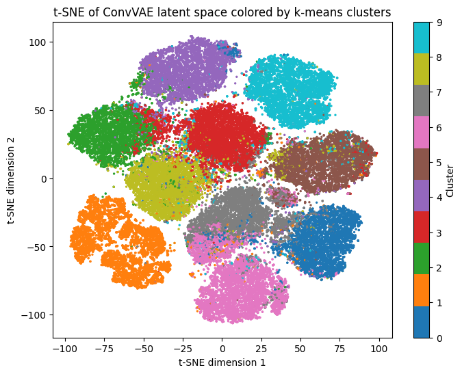
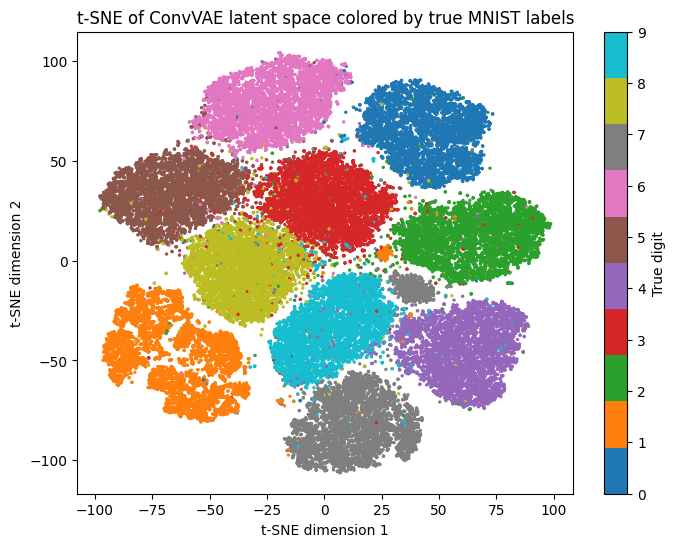
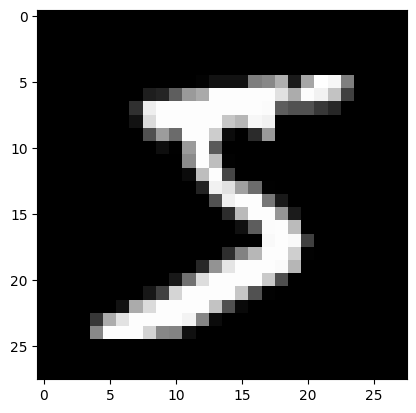
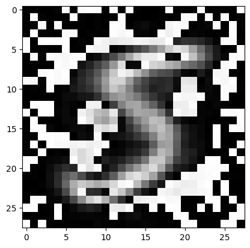
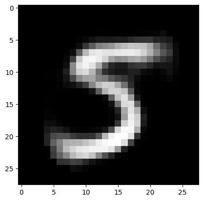
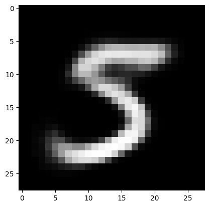
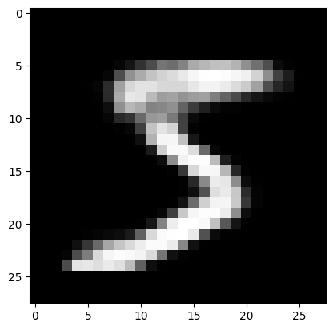
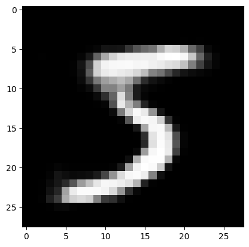

# Project for Introduction to Deep Learning
This repo contains my implementation and data for my project for my *Introduction to Deep Learning class* at the University of Luxembourg (summer semester 2026).

The goal of this project was to:
1. Use Autoencoders to map a dataset to a latent space,
2. Use K-means on the latent space and then
3. compare the true labels and the clustered labels to see if the pipeline managed to retrieve the true labels.

The idea came from the paper [Unsupervised Deep Embedding for Clustering Analysis](https://arxiv.org/pdf/1511.06335) (DEC), which made me want to explore further AE architectures to analyse the results and perhaps achieve better scores.

The project was documented in a report, [DeepL Project.pdf](DeepL%20Project.pdf), that can be found in the repo root.

MNIST was the only dataset that was utilized in this project, for simplicity reasons and because the mentioned paper also used it allowing me to draw direct comparisons in my analysis.

I implemented increasingly better performing Stacked Autoencoders (SAE), Autoencoders using Convolutional Layers and Variational Autoencoder (VAE).
My best model, a convolutional VAE with three convolutional layers, reached a clustering accuracy of 85.73%, above the 81.84% the DEC paper reports for its AE + k-means baseline.
The different architectures are separated in different notebooks. All show the architecture, the training, the final embedding, the k-means application and at the end various metrics to assess how well the resulting clusters resemble the true labels.
Many samples of the reconstruction of the AE's are shown in the notebooks.

<p>
  
  
</p>

*t-SNE of the latent space of the best ConvVAE, coloured by k-means cluster (left) and by the true digit (right).*

*Note: the id given by the k-means (left) does not try to represent the true digit*

## Results
All models use a 10-dimensional latent space. After training only the encoder is kept: it maps all 70,000 MNIST images (training and test set) to the latent space, where k-means (10 clusters, `n_init = 20`, `random_state = 42`) groups them. For the VAEs the mean vector is used. The clusters are compared with the true labels using clustering accuracy (best one-to-one match between clusters and digits), ARI and NMI.

| Model | Main change | Notebook | Accuracy | ARI | NMI |
|---|---|---|---|---|---|
| SAE baseline | DEC architecture: MSE loss, no output activation | `minst_none.ipynb` | 65.72% | 47.61% | 56.91% |
| SAE + sigmoid output | Final decoder output bounded to [0, 1] | `minst_decode_sigmoid.ipynb` | 75.44% | 60.10% | 66.87% |
| SAE + sigmoid + BCE | BCE for the image reconstruction stages | `minst_decode_sigmoid_bce.ipynb` | 79.24% | 66.42% | 72.56% |
| Convolutional AE | Two convolutional layers; latent space standardized before k-means | `mnist_train2.ipynb` | 80.36% | 67.98% | 73.17% |
| Simple VAE | Fully connected, 784 → 500 → 500 → 10 | `vae.ipynb` | 78.68% | 63.64% | 67.03% |
| Deeper VAE | SAE-like dense architecture | `vae.ipynb` | 64.24% | 47.87% | 53.83% |
| ConvVAE, β = 1 | Convolutional VAE, fixed KL weight | `conv_vae.ipynb` | 81.79% | 66.67% | 70.96% |
| ConvVAE, β warm-up | β = min(1, epoch / 50) | `conv_vae_beta.ipynb` | 81.28% | 67.59% | 72.41% |
| Expanded ConvVAE, β = 1 | Third convolutional layer, [64, 7, 7] → [128, 4, 4] | `conv_vae.ipynb` | **85.73%** | **72.92%** | **75.53%** |

<details>
<summary>Other experiments in the notebooks</summary>

| Experiment | Notebook | Accuracy | ARI | NMI |
|---|---|---|---|---|
| SAE with sigmoid on the output and on the latent layer | `minst_sigmoid.ipynb` | 57.79% | 42.66% | 55.42% |
| SAE + sigmoid + BCE, batch size 1024 | `minst_decode_sigmoid_bce_less_iterations.ipynb` | 78.79% | 65.32% | 72.15% |
| SAE + sigmoid + BCE trained with AdamW | `mnist_train.ipynb` | 71.61% | 55.78% | 64.04% |
| SAE with an extra layer, 2000 → 500 → 10 | `mnist_train.ipynb` | 78.37% | 64.89% | 70.86% |
| SAE with a 20-dimensional latent space | `mnist_train.ipynb` | 65.04% | 47.08% | 56.72% |
| SAE + sigmoid + BCE, latent space standardized before k-means | `mnist_train2.ipynb` | 80.15% | 67.81% | 73.41% |
| Convolutional AE, latent space not standardized | `mnist_train2.ipynb` | 79.58% | 67.19% | 72.51% |
| Convolutional AE with max pooling, latent space standardized before k-means | `mnist_train2.ipynb` | 74.10% | 60.07% | 67.74% |
| ConvVAE, β = 0.5 | `conv_vae_beta.ipynb` | 80.66% | 67.10% | 72.51% |

</details>

### Reconstructions
The same digit reconstructed by different models. Without an output activation the SAE's reconstruction has artifacts in the background; bounding the output with a sigmoid removes them.

| Original | SAE baseline | + sigmoid | + sigmoid + BCE | Convolutional AE | Simple VAE | Expanded ConvVAE |
|---|---|---|---|---|---|---|
|  |  |  |  |  |  |  |

## How it works
- **SAE (DEC replication):** 784 → 500 → 500 → 2000 → 10, as in the DEC paper: ReLU on every layer except the latent layer and the output layer. Each encoder/decoder pair is pretrained greedily as a denoising autoencoder with 20% dropout (200 epochs per layer, about 55,000 iterations; the paper uses 50,000), then the whole autoencoder is fine-tuned without dropout (400 epochs, about 110,000 iterations; the paper uses 100,000). SGD with learning rate 0.1 and momentum 0.9, the learning rate is multiplied by 0.1 every 20,000 iterations, batch size 256.
- **Convolutional AE:** two `Conv2d` layers (kernel 3, stride 2, padding 1), [1, 28, 28] → [32, 14, 14] → [64, 7, 7], then a fully connected layer to the latent space. The decoder mirrors it with `ConvTranspose2d` and a sigmoid output. BCE loss, AdamW (learning rate 0.001, weight decay 0.0001), 400 epochs.
- **VAEs:** the encoder outputs a mean and a log-variance, a latent vector is sampled with the reparameterization trick, and the loss is the ELBO: BCE reconstruction loss plus β times the KL divergence. AdamW with the same settings, 400 epochs. The convolutional VAEs use the encoder and decoder layout of the convolutional AE.

## Repository structure
| Path | Contents |
|---|---|
| `minst_none.ipynb`, `minst_decode_sigmoid.ipynb`, `minst_decode_sigmoid_bce.ipynb` | The SAE steps from the results table |
| `minst_sigmoid.ipynb`, `minst_decode_sigmoid_bce_less_iterations.ipynb` | Further SAE variants |
| `mnist_train.ipynb` | SAE experiments: AdamW, an extra layer, a larger latent space |
| `mnist_train2.ipynb` | SAE with standardized latent space, convolutional AEs |
| `vae.ipynb` | Simple and deeper fully connected VAE |
| `conv_vae.ipynb` | ConvVAE and expanded ConvVAE |
| `conv_vae_beta.ipynb` | ConvVAE with β = 0.5 and with β warm-up |
| `models/` | Trained weights of every run (PyTorch state dicts) |
| `dataset/` | MNIST raw files, as downloaded by torchvision |
| `reconstructions/` | Reconstruction samples and t-SNE plots |
| `DeepL Project.pdf` | The report |

## Running the notebooks
```
pip install -r requirements.txt
```
I ran the notebooks with Python 3.11 and 3.14. PyTorch uses CUDA if it is available, otherwise the CPU.

The notebooks load MNIST from `dataset/` and the trained weights from `models/`. The training cells retrain from scratch and overwrite the saved weights. Skip them to use the saved weights.

## References
1. Irina Higgins et al. 2017. [β-VAE: Learning Basic Visual Concepts with a Constrained Variational Framework](https://openreview.net/forum?id=Sy2fzU9gl). The β weight on the KL divergence in the VAE loss.
2. Geoffrey E. Hinton and Ruslan R. Salakhutdinov. 2006. [Reducing the Dimensionality of Data with Neural Networks](https://doi.org/10.1126/science.1127647). Autoencoders for low-dimensional representations, compared with PCA.
3. Lawrence Hubert and Phipps Arabie. 1985. [Comparing Partitions](https://doi.org/10.1007/BF01908075). The adjusted Rand index (ARI).
4. Diederik P. Kingma and Max Welling. 2013. [Auto-Encoding Variational Bayes](https://arxiv.org/abs/1312.6114). The variational autoencoder.
5. Yann LeCun, Léon Bottou, Yoshua Bengio and Patrick Haffner. 1998. [Gradient-based learning applied to document recognition](https://doi.org/10.1109/5.726791). Convolutional layers for image feature extraction.
6. Yann LeCun and Corinna Cortes. 2010. [MNIST handwritten digit database](http://yann.lecun.com/exdb/mnist/). Loaded with torchvision.
7. Ilya Loshchilov and Frank Hutter. 2019. [Decoupled Weight Decay Regularization](https://arxiv.org/abs/1711.05101). The AdamW optimizer.
8. James MacQueen. 1967. [Some methods for classification and analysis of multivariate observations](https://api.semanticscholar.org/CorpusID:6278891). The k-means algorithm.
9. Alexander Strehl and Joydeep Ghosh. 2002. [Cluster Ensembles – A Knowledge Reuse Framework for Combining Multiple Partitions](https://www.jmlr.org/papers/v3/strehl02a.html). Normalized mutual information (NMI).
10. Junyuan Xie, Ross Girshick and Ali Farhadi. 2016. [Unsupervised Deep Embedding for Clustering Analysis](https://arxiv.org/abs/1511.06335). Architecture and hyperparameters of the SAE baseline.

## License
My own code is licensed under MIT, see [LICENSE](LICENSE). The MNIST dataset in `dataset/` is not mine and keeps its own terms.
